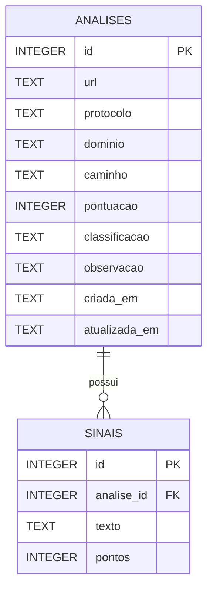

# Etapa 07 — Persistência e CRUD com banco de dados

## Resumo

Na Etapa 6 os dados ficavam em um arquivo JSON (`db.json`) que era lido e reescrito por inteiro. Agora eles ficam em um **banco de dados relacional SQLite**, com **duas tabelas relacionadas** (`analises` e `sinais`). A API continua com os mesmos endereços, respostas e códigos HTTP: o front-end e a coleção do Postman **não precisaram mudar**.

| Requisito | Resultado |
|---|---|
| Banco de dados | SQLite (`node:sqlite`, embutido no Node.js) |
| Duas entidades relacionadas | `analises` 1:N `sinais` |
| CRUD | POST, GET (lista e individual), PUT, PATCH, DELETE |
| Persistência entre reinicializações | arquivo `data/analisalink.db` (testado) |
| Validações | na API e no próprio banco |
| Erros de persistência | tratados (seção própria) |
| Baixo acoplamento | só `repository.js` conhece SQL |

## Escolha do banco de dados

**Banco relacional, SQLite.** Justificativa:

- **Por que relacional:** os dados têm estrutura fixa e uma relação natural (uma análise tem vários sinais). O banco relacional garante a integridade por conta própria (chave estrangeira, `NOT NULL`, `CHECK`) e permite consultas com `JOIN`.
- **Por que SQLite:** não precisa instalar nem configurar um servidor de banco; tudo fica em **um arquivo**; é o banco previsto na proposta da Etapa 01 (SQLite); tem transações (tudo ou nada). O módulo `node:sqlite` já vem no Node.js 22.13 ou superior, então **não há nenhuma dependência para instalar**: quem for executar o projeto só precisa do Node.

| Alternativa | Por que não |
|---|---|
| Arquivo JSON (Etapa 6) | sem integridade, sem consulta, reescreve o arquivo inteiro a cada alteração, sem relacionamento |
| MongoDB (NoSQL) | os dados já são estruturados e relacionados; exigiria instalar um servidor e um driver, sem ganho para este domínio |
| PostgreSQL / MySQL | são a escolha certa para muitos usuários simultâneos, mas exigem servidor, usuário e senha; desproporcional para o escopo |

**Limitações assumidas:** o SQLite aceita uma escrita por vez (adequado para o uso acadêmico); o `node:sqlite` ainda é marcado pelo Node.js como em desenvolvimento ativo, e por isso o terminal mostra um aviso `ExperimentalWarning` ao iniciar (esperado, não é erro); exige Node.js 22.13 ou superior (confira com `node -v`). **Caminho de evolução:** para migrar para PostgreSQL, bastaria reescrever `server/repository.js` mantendo as mesmas funções.

## Como criar o banco e executar

Pré-requisito: Node.js 22.13 ou superior.

```bash
npm run db:criar     # cria data/analisalink.db e as tabelas (opcional: a API também cria ao iniciar)
npm run db:exemplo   # insere 3 análises de exemplo (somente se o banco estiver vazio)
npm start            # liga a API em http://localhost:3000
```

- O comando `db:criar` executa o arquivo `server/db/schema.sql`, que usa `CREATE TABLE IF NOT EXISTS`: pode ser rodado várias vezes **sem apagar dados**.
- O arquivo do banco é `data/analisalink.db` (ignorado pelo Git, porque é gerado). A variável de ambiente `DB_FILE` troca o caminho.
- Para **recomeçar do zero**: pare a API e apague o arquivo `data/analisalink.db`.
- Para olhar o conteúdo, qualquer visualizador de SQLite serve (por exemplo o DB Browser for SQLite ou uma extensão do VS Code); as consultas da seção de exemplos podem ser coladas lá.
- O front-end funciona como antes: abra `src/tela-inicial.html` com o Live Server.

## Modelo do banco



Script de criação (`server/db/schema.sql`):

```sql
-- Modelo do banco do AnalisaLink (SQLite)
-- Relacionamento: uma ANALISE possui vários SINAIS (1:N).
-- O script é idempotente: pode ser executado várias vezes sem apagar dados.

CREATE TABLE IF NOT EXISTS analises (
  id             INTEGER PRIMARY KEY AUTOINCREMENT,
  url            TEXT    NOT NULL,
  protocolo      TEXT    NOT NULL,
  dominio        TEXT    NOT NULL,
  caminho        TEXT    NOT NULL,
  pontuacao      INTEGER NOT NULL CHECK (pontuacao BETWEEN 0 AND 100),
  classificacao  TEXT    NOT NULL CHECK (classificacao IN ('Baixa atenção', 'Atenção moderada', 'Suspeita')),
  observacao     TEXT    NOT NULL DEFAULT '',
  criada_em      TEXT    NOT NULL DEFAULT (strftime('%Y-%m-%dT%H:%M:%fZ', 'now')),
  atualizada_em  TEXT
);

CREATE TABLE IF NOT EXISTS sinais (
  id          INTEGER PRIMARY KEY AUTOINCREMENT,
  analise_id  INTEGER NOT NULL REFERENCES analises (id) ON DELETE CASCADE,
  texto       TEXT    NOT NULL,
  pontos      INTEGER NOT NULL CHECK (pontos > 0)
);

CREATE INDEX IF NOT EXISTS idx_sinais_analise ON sinais (analise_id);
CREATE INDEX IF NOT EXISTS idx_analises_classificacao ON analises (classificacao);
```

## Entidades

### `analises`: cada URL analisada

| Coluna | Tipo | Restrições | Descrição |
|---|---|---|---|
| `id` | INTEGER | chave primária, `AUTOINCREMENT` | identificador; **não é reaproveitado** após exclusões |
| `url` | TEXT | `NOT NULL` | a URL informada |
| `protocolo` | TEXT | `NOT NULL` | `http` ou `https` |
| `dominio` | TEXT | `NOT NULL` | nome do host |
| `caminho` | TEXT | `NOT NULL` | caminho, parâmetros e fragmento |
| `pontuacao` | INTEGER | `NOT NULL`, `CHECK` entre 0 e 100 | pontuação de atenção |
| `classificacao` | TEXT | `NOT NULL`, `CHECK` em ('Baixa atenção', 'Atenção moderada', 'Suspeita') | resultado da classificação |
| `observacao` | TEXT | `NOT NULL`, padrão `''` | anotação do usuário (até 200 caracteres, validado na API) |
| `criada_em` | TEXT | `NOT NULL`, padrão = agora (UTC, ISO 8601) | data de criação |
| `atualizada_em` | TEXT | pode ser nulo | data da última alteração (PUT ou PATCH) |

### `sinais`: cada característica suspeita encontrada em uma análise

| Coluna | Tipo | Restrições | Descrição |
|---|---|---|---|
| `id` | INTEGER | chave primária, `AUTOINCREMENT` | identificador |
| `analise_id` | INTEGER | `NOT NULL`, chave estrangeira para `analises(id)`, `ON DELETE CASCADE` | a que análise o sinal pertence |
| `texto` | TEXT | `NOT NULL` | descrição do sinal (ex.: "Usa HTTP em vez de HTTPS.") |
| `pontos` | INTEGER | `NOT NULL`, `CHECK` maior que 0 | pontos que o sinal vale |

## Relacionamentos

**`analises` 1:N `sinais`** (uma análise possui zero ou mais sinais; cada sinal pertence a uma única análise).

- Implementado pela chave estrangeira `sinais.analise_id`, com índice (`idx_sinais_analise`) para as consultas.
- **Exclusão em cascata:** ao excluir uma análise, o próprio banco apaga os sinais dela (`ON DELETE CASCADE`). Para isso a conexão ativa `PRAGMA foreign_keys = ON` (o SQLite deixa desligado por padrão).
- **Na API** o relacionamento aparece aninhado, como antes: `"signals": [ { "texto": "...", "pontos": 15 } ]`.
- Por que separar em duas tabelas: antes os sinais eram uma lista dentro do registro. Em uma tabela própria eles podem ser consultados e somados com SQL (por exemplo, "quantas análises têm o sinal X"), e o banco impede sinais "órfãos".

## Validações

| Camada | Onde | O que valida |
|---|---|---|
| API | `server/server.js` e `server/controller.js` | JSON válido, tipo do conteúdo, tamanho, `url` obrigatória e válida (http/https), `observacao` com até 200 caracteres, id inteiro positivo, filtros permitidos |
| Repositório | `server/repository.js` | só colunas de uma lista fixa entram nos `UPDATE`; todas as consultas usam parâmetros (`?`), nunca texto concatenado, o que impede **injeção de SQL**; `%` e `_` na busca são tratados como texto comum |
| Banco | `server/db/schema.sql` | `NOT NULL`, `CHECK` (pontuação de 0 a 100, classificação permitida, pontos positivos) e chave estrangeira |

A camada do banco é a rede de segurança: mesmo que algum código futuro deixe passar um dado inválido, o banco o recusa (há um teste que prova isso).

## Tratamento de erros de persistência

| Situação | Onde é tratada | Comportamento |
|---|---|---|
| Node.js sem `node:sqlite` (versão antiga) | `server/db/conexao.js` | mensagem explicando a versão necessária; o programa encerra (código 1) |
| Pasta inacessível ou arquivo de banco corrompido | `server/db/conexao.js` | mensagem "Não foi possível abrir o banco de dados..." com o motivo; encerra (código 1) |
| Falha de uma operação com a API em funcionamento (disco cheio, arquivo bloqueado, tabela ausente...) | `executar()` em `server/repository.js` | responde **500** com `ERRO_BANCO` e mensagem genérica; o detalhe técnico vai só para o log do servidor, sem vazar para o cliente |
| Falha no meio de uma gravação com várias tabelas | `transacao()` em `server/db/conexao.js` | `ROLLBACK`: ou grava tudo (análise e sinais) ou nada |
| Dado inválido que passe pela API | restrições do banco | o banco recusa e o erro vira o 500 acima |

## Baixo acoplamento entre API e banco

```
server.js  ->  routes.js  ->  controller.js  ->  repository.js  ->  db/conexao.js  ->  SQLite
 (HTTP)         (rotas)        (regras e           (SQL e              (abre o banco,
                                validação)         tradução)            transações)
```

- **Só `repository.js` contém SQL.** O controller importa o repositório como um conjunto de funções e não sabe se atrás há SQLite, JSON ou outro banco.
- **Contrato do repositório** (o que o controller pode usar):

| Função | Faz | Devolve |
|---|---|---|
| `listar({ busca, classificacao, ordem })` | consulta com filtros | lista de análises |
| `buscarPorId(id)` | consulta uma | análise ou `null` |
| `criar(dados)` | grava análise e sinais | análise criada |
| `substituir(id, dados)` | PUT | análise ou `null` |
| `atualizar(id, parcial)` | PATCH | análise ou `null` |
| `excluir(id)` | DELETE | `true` ou `false` |

- **O formato da API é independente do banco:** a função `paraApi()` traduz colunas (`pontuacao`, `dominio`) para os campos da API (`score`, `domain`). Mudar o nome de uma coluna não muda o JSON.
- **Prova:** os 17 testes da Etapa 6 continuam passando **sem nenhuma alteração**, o front-end (`src/js/api.js`) não mudou, e a coleção do Postman passa inteira.

## Persistência entre reinicializações

Como demonstrar:

1. `npm start`, depois crie uma análise (exemplos abaixo).
2. Pare a API (Ctrl+C) e ligue de novo com `npm start`.
3. `curl -i http://localhost:3000/analises`: a análise continua lá.

Resultado real desse teste (depois de criar, alterar e excluir, a API foi reiniciada e consultada):

```json
[
  {
    "id": 1,
    "url": "http://banco@site-falso.com/conta/verify",
    "protocol": "http",
    "domain": "site-falso.com",
    "path": "/conta/verify",
    "score": 60,
    "classification": "Suspeita",
    "signals": [
      {
        "texto": "Usa HTTP em vez de HTTPS.",
        "pontos": 15
      },
      {
        "texto": "Contém o caractere @.",
        "pontos": 25
      },
      {
        "texto": "Contém a palavra \"conta\".",
        "pontos": 10
      },
      {
        "texto": "Contém a palavra \"verify\".",
        "pontos": 10
      }
    ],
    "observacao": "Confirmado como golpe",
    "date": "25/11/2026, 20:24:51",
    "atualizadoEm": "25/11/2026, 20:24:51"
  }
]
```

Há um teste automático para isso (`persistência: os dados continuam no banco depois de reiniciar o servidor`).

## Exemplos de operações CRUD

Os exemplos foram gerados executando a API de verdade, começando com o banco vazio, na ordem em que aparecem (cada um depende dos anteriores). No Windows (CMD), troque as aspas do `-d` por aspas duplas escapadas ou use a coleção do Postman (`docs/postman/`).

### Criar uma análise (POST)

**Requisição**

```bash
curl -i -X POST http://localhost:3000/analises -H "Content-Type: application/json" -d '{"url": "http://192.168.0.10/login", "observacao": "Recebido por e-mail"}'
```

**SQL executado pelo repositório**

```sql
BEGIN;
INSERT INTO analises (url, protocolo, dominio, caminho, pontuacao, classificacao, observacao)
  VALUES (?, ?, ?, ?, ?, ?, ?);
INSERT INTO sinais (analise_id, texto, pontos) VALUES (?, ?, ?);   -- um para cada sinal
COMMIT;                                                              -- (ROLLBACK se algo falhar)
```

**Resposta**

```http
HTTP/1.1 201 Created
Location: /analises/1
Content-Type: application/json; charset=utf-8

{
  "id": 1,
  "url": "http://192.168.0.10/login",
  "protocol": "http",
  "domain": "192.168.0.10",
  "path": "/login",
  "score": 55,
  "classification": "Suspeita",
  "signals": [
    {
      "texto": "Usa HTTP em vez de HTTPS.",
      "pontos": 15
    },
    {
      "texto": "Usa um endereço IP no lugar de um domínio.",
      "pontos": 30
    },
    {
      "texto": "Contém a palavra \"login\".",
      "pontos": 10
    }
  ],
  "observacao": "Recebido por e-mail",
  "date": "25/11/2026, 20:24:51"
}
```

### Criar outra análise (POST)

**Requisição**

```bash
curl -i -X POST http://localhost:3000/analises -H "Content-Type: application/json" -d '{"url": "https://www.exemplo.com.br"}'
```

**SQL executado pelo repositório**

```sql
-- mesma sequência do exemplo anterior (BEGIN, INSERTs, COMMIT)
```

**Resposta**

```http
HTTP/1.1 201 Created
Location: /analises/2
Content-Type: application/json; charset=utf-8

{
  "id": 2,
  "url": "https://www.exemplo.com.br",
  "protocol": "https",
  "domain": "www.exemplo.com.br",
  "path": "/",
  "score": 0,
  "classification": "Baixa atenção",
  "signals": [],
  "observacao": "",
  "date": "25/11/2026, 20:24:51"
}
```

### Listar todas (GET)

**Requisição**

```bash
curl -i -X GET http://localhost:3000/analises
```

**SQL executado pelo repositório**

```sql
SELECT * FROM analises ORDER BY id DESC;
SELECT analise_id, texto, pontos FROM sinais WHERE analise_id IN (?, ?) ORDER BY id;
```

**Resposta**

```http
HTTP/1.1 200 OK
Content-Type: application/json; charset=utf-8

[
  {
    "id": 2,
    "url": "https://www.exemplo.com.br",
    "protocol": "https",
    "domain": "www.exemplo.com.br",
    "path": "/",
    "score": 0,
    "classification": "Baixa atenção",
    "signals": [],
    "observacao": "",
    "date": "25/11/2026, 20:24:51"
  },
  {
    "id": 1,
    "url": "http://192.168.0.10/login",
    "protocol": "http",
    "domain": "192.168.0.10",
    "path": "/login",
    "score": 55,
    "classification": "Suspeita",
    "signals": [
      {
        "texto": "Usa HTTP em vez de HTTPS.",
        "pontos": 15
      },
      {
        "texto": "Usa um endereço IP no lugar de um domínio.",
        "pontos": 30
      },
      {
        "texto": "Contém a palavra \"login\".",
        "pontos": 10
      }
    ],
    "observacao": "Recebido por e-mail",
    "date": "25/11/2026, 20:24:51"
  }
]
```

### Listar com filtros (GET)

**Requisição**

```bash
curl -i -X GET 'http://localhost:3000/analises?classificacao=Suspeita&busca=login&ordem=asc'
```

**SQL executado pelo repositório**

```sql
SELECT * FROM analises
 WHERE lower(url || ' ' || classificacao) LIKE ? ESCAPE '\'   -- ? = '%login%'
   AND classificacao = ?                                         -- ? = 'Suspeita'
 ORDER BY id ASC;
SELECT analise_id, texto, pontos FROM sinais WHERE analise_id IN (?) ORDER BY id;
```

**Resposta**

```http
HTTP/1.1 200 OK
Content-Type: application/json; charset=utf-8

[
  {
    "id": 1,
    "url": "http://192.168.0.10/login",
    "protocol": "http",
    "domain": "192.168.0.10",
    "path": "/login",
    "score": 55,
    "classification": "Suspeita",
    "signals": [
      {
        "texto": "Usa HTTP em vez de HTTPS.",
        "pontos": 15
      },
      {
        "texto": "Usa um endereço IP no lugar de um domínio.",
        "pontos": 30
      },
      {
        "texto": "Contém a palavra \"login\".",
        "pontos": 10
      }
    ],
    "observacao": "Recebido por e-mail",
    "date": "25/11/2026, 20:24:51"
  }
]
```

### Consultar uma análise (GET)

**Requisição**

```bash
curl -i -X GET http://localhost:3000/analises/1
```

**SQL executado pelo repositório**

```sql
SELECT * FROM analises WHERE id = ?;
SELECT analise_id, texto, pontos FROM sinais WHERE analise_id IN (?) ORDER BY id;
```

**Resposta**

```http
HTTP/1.1 200 OK
Content-Type: application/json; charset=utf-8

{
  "id": 1,
  "url": "http://192.168.0.10/login",
  "protocol": "http",
  "domain": "192.168.0.10",
  "path": "/login",
  "score": 55,
  "classification": "Suspeita",
  "signals": [
    {
      "texto": "Usa HTTP em vez de HTTPS.",
      "pontos": 15
    },
    {
      "texto": "Usa um endereço IP no lugar de um domínio.",
      "pontos": 30
    },
    {
      "texto": "Contém a palavra \"login\".",
      "pontos": 10
    }
  ],
  "observacao": "Recebido por e-mail",
  "date": "25/11/2026, 20:24:51"
}
```

### Substituir (PUT)

**Requisição**

```bash
curl -i -X PUT http://localhost:3000/analises/1 -H "Content-Type: application/json" -d '{"url": "http://banco@site-falso.com/conta/verify", "observacao": "URL corrigida"}'
```

**SQL executado pelo repositório**

```sql
BEGIN;
UPDATE analises SET url = ?, protocolo = ?, dominio = ?, caminho = ?, pontuacao = ?,
       classificacao = ?, observacao = ?, atualizada_em = strftime('%Y-%m-%dT%H:%M:%fZ', 'now')
 WHERE id = ?;
DELETE FROM sinais WHERE analise_id = ?;                     -- os sinais antigos saem...
INSERT INTO sinais (analise_id, texto, pontos) VALUES (?, ?, ?);   -- ...e os novos entram
COMMIT;
```

**Resposta**

```http
HTTP/1.1 200 OK
Content-Type: application/json; charset=utf-8

{
  "id": 1,
  "url": "http://banco@site-falso.com/conta/verify",
  "protocol": "http",
  "domain": "site-falso.com",
  "path": "/conta/verify",
  "score": 60,
  "classification": "Suspeita",
  "signals": [
    {
      "texto": "Usa HTTP em vez de HTTPS.",
      "pontos": 15
    },
    {
      "texto": "Contém o caractere @.",
      "pontos": 25
    },
    {
      "texto": "Contém a palavra \"conta\".",
      "pontos": 10
    },
    {
      "texto": "Contém a palavra \"verify\".",
      "pontos": 10
    }
  ],
  "observacao": "URL corrigida",
  "date": "25/11/2026, 20:24:51",
  "atualizadoEm": "25/11/2026, 20:24:51"
}
```

### Alterar parcialmente (PATCH)

**Requisição**

```bash
curl -i -X PATCH http://localhost:3000/analises/1 -H "Content-Type: application/json" -d '{"observacao": "Confirmado como golpe"}'
```

**SQL executado pelo repositório**

```sql
UPDATE analises SET observacao = ?, atualizada_em = strftime('%Y-%m-%dT%H:%M:%fZ', 'now')
 WHERE id = ?;
-- se a url também fosse enviada: atualiza as colunas da análise e troca os sinais (DELETE + INSERT)
```

**Resposta**

```http
HTTP/1.1 200 OK
Content-Type: application/json; charset=utf-8

{
  "id": 1,
  "url": "http://banco@site-falso.com/conta/verify",
  "protocol": "http",
  "domain": "site-falso.com",
  "path": "/conta/verify",
  "score": 60,
  "classification": "Suspeita",
  "signals": [
    {
      "texto": "Usa HTTP em vez de HTTPS.",
      "pontos": 15
    },
    {
      "texto": "Contém o caractere @.",
      "pontos": 25
    },
    {
      "texto": "Contém a palavra \"conta\".",
      "pontos": 10
    },
    {
      "texto": "Contém a palavra \"verify\".",
      "pontos": 10
    }
  ],
  "observacao": "Confirmado como golpe",
  "date": "25/11/2026, 20:24:51",
  "atualizadoEm": "25/11/2026, 20:24:51"
}
```

### Excluir (DELETE)

**Requisição**

```bash
curl -i -X DELETE http://localhost:3000/analises/2
```

**SQL executado pelo repositório**

```sql
DELETE FROM analises WHERE id = ?;
-- os sinais dessa análise são apagados pelo próprio banco (ON DELETE CASCADE)
```

**Resposta**

```http
HTTP/1.1 204 No Content
```

### Erros

### Erro de validação (400)

**Requisição**

```bash
curl -i -X POST http://localhost:3000/analises -H "Content-Type: application/json" -d '{"url": "exemplo.com"}'
```

**SQL executado pelo repositório**

```sql
-- nenhum SQL é executado: a validação recusa a requisição antes de chegar ao banco
```

**Resposta**

```http
HTTP/1.1 400 Bad Request
Content-Type: application/json; charset=utf-8

{
  "erro": {
    "status": 400,
    "codigo": "VALIDACAO",
    "mensagem": "Dados inválidos.",
    "detalhes": [
      {
        "campo": "url",
        "mensagem": "URL inválida. Use o formato completo, como https://exemplo.com"
      }
    ]
  }
}
```

### Análise inexistente (404)

**Requisição**

```bash
curl -i -X GET http://localhost:3000/analises/999
```

**SQL executado pelo repositório**

```sql
SELECT * FROM analises WHERE id = ?;   -- não devolve linhas, então a API responde 404
```

**Resposta**

```http
HTTP/1.1 404 Not Found
Content-Type: application/json; charset=utf-8

{
  "erro": {
    "status": 404,
    "codigo": "NAO_ENCONTRADO",
    "mensagem": "Análise 999 não encontrada."
  }
}
```

### Estado das tabelas

**Depois dos dois POST**

`SELECT id, url, pontuacao, classificacao, observacao FROM analises;`

| id | url | pontuacao | classificacao | observacao |
|---|---|---|---|---|
| 1 | http://192.168.0.10/login | 55 | Suspeita | Recebido por e-mail |
| 2 | https://www.exemplo.com.br | 0 | Baixa atenção |  |

`SELECT a.id AS analise, s.id AS sinal, s.texto, s.pontos FROM analises a JOIN sinais s ON s.analise_id = a.id;`

| analise | sinal | texto | pontos |
|---|---|---|---|
| 1 | 1 | Usa HTTP em vez de HTTPS. | 15 |
| 1 | 2 | Usa um endereço IP no lugar de um domínio. | 30 |
| 1 | 3 | Contém a palavra "login". | 10 |

**Depois do PUT na análise 1 (os sinais antigos foram trocados pelos novos)**

`SELECT id, url, pontuacao, classificacao, observacao FROM analises;`

| id | url | pontuacao | classificacao | observacao |
|---|---|---|---|---|
| 1 | http://banco@site-falso.com/conta/verify | 60 | Suspeita | URL corrigida |
| 2 | https://www.exemplo.com.br | 0 | Baixa atenção |  |

`SELECT a.id AS analise, s.id AS sinal, s.texto, s.pontos FROM analises a JOIN sinais s ON s.analise_id = a.id;`

| analise | sinal | texto | pontos |
|---|---|---|---|
| 1 | 4 | Usa HTTP em vez de HTTPS. | 15 |
| 1 | 5 | Contém o caractere @. | 25 |
| 1 | 6 | Contém a palavra "conta". | 10 |
| 1 | 7 | Contém a palavra "verify". | 10 |

**Depois do DELETE da análise 2 (o sinal dela foi apagado em cascata)**

`SELECT id, url, pontuacao, classificacao, observacao FROM analises;`

| id | url | pontuacao | classificacao | observacao |
|---|---|---|---|---|
| 1 | http://banco@site-falso.com/conta/verify | 60 | Suspeita | Confirmado como golpe |

`SELECT a.id AS analise, s.id AS sinal, s.texto, s.pontos FROM analises a JOIN sinais s ON s.analise_id = a.id;`

| analise | sinal | texto | pontos |
|---|---|---|---|
| 1 | 4 | Usa HTTP em vez de HTTPS. | 15 |
| 1 | 5 | Contém o caractere @. | 25 |
| 1 | 6 | Contém a palavra "conta". | 10 |
| 1 | 7 | Contém a palavra "verify". | 10 |

## Requisitos da etapa e onde verificar

| Requisito | Evidência |
|---|---|
| 1. Utilizar um banco de dados | SQLite em `data/analisalink.db`; conexão em `server/db/conexao.js` |
| 2. Duas entidades relacionadas | `analises` 1:N `sinais` em `server/db/schema.sql` |
| 3. Criar, consultar, atualizar e excluir | `server/repository.js`; exemplos acima |
| 4. Persistir entre reinicializações | seção própria e teste automático |
| 5. Validações | na API (`controller.js`), no repositório (parâmetros) e no banco (`CHECK`, `NOT NULL`, chave estrangeira) |
| 6. Tratar erros de persistência | `executar()`, `transacao()` e tratamento na abertura do banco; testes de falha |
| 7. Evitar acoplamento entre API e banco | contrato do repositório; os 17 testes da Etapa 6 passam sem mudança |
| Explicar a escolha do banco | seção "Escolha do banco de dados" |
| Entregáveis: modelo, entidades, relacionamentos, criação do banco e exemplos de CRUD | este documento |

## Testes

`npm test` executa 25 testes (usam outra porta e um banco temporário, sem tocar em `data/`):
- os 17 testes da API da Etapa 6, sem alteração;
- sinais em tabela separada e exclusão em cascata;
- troca dos sinais ao alterar a URL (PATCH);
- ids não reaproveitados após excluir o último registro;
- busca com `%` e `_` tratados como texto;
- o banco recusa dados inválidos (`CHECK` e chave estrangeira);
- persistência após reiniciar o servidor;
- arquivo de banco inválido impede o servidor de subir, com mensagem clara;
- falha do banco em funcionamento vira 500 genérico, sem vazar detalhes.

## O que mudou em relação à Etapa 6

- `db.json` e a leitura/gravação de arquivo foram substituídos por SQLite (`server/db/` e `server/repository.js`);
- o `controller.js` passou a usar o repositório por funções (sem lógica de arquivo);
- a data é guardada em formato ISO no banco e exibida em `dd/mm/aaaa, hh:mm:ss` pela API;
- novos comandos: `npm run db:criar` e `npm run db:exemplo`;
- a API, o front-end e a coleção do Postman continuam iguais.
