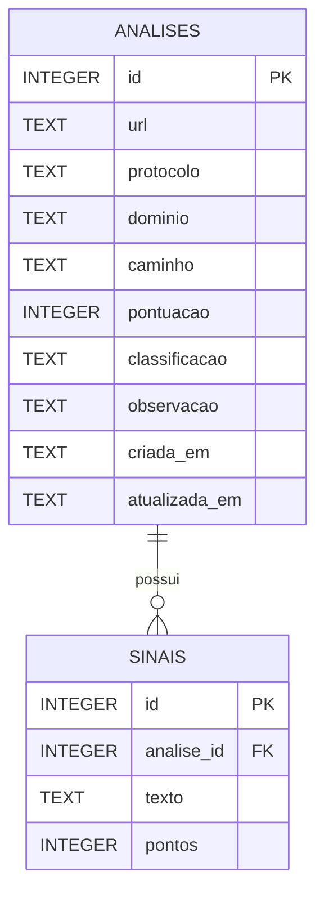

# Etapa 07 — Persistência e CRUD com banco de dados

## O que foi feito

Os dados da API, que ficavam no arquivo `db.json`, agora ficam em um **banco de dados SQLite**, com **duas tabelas relacionadas**. A API, o front-end e a coleção do Postman continuam iguais.

## Escolha do banco: SQLite (relacional)

- **Relacional:** os dados têm estrutura fixa e uma relação clara (uma análise tem vários sinais). O banco garante a integridade (chave estrangeira, campos obrigatórios, valores permitidos).
- **SQLite:** não precisa instalar servidor; o banco é **um único arquivo**; já estava previsto na proposta da Etapa 01. O módulo `node:sqlite` vem no Node.js (22.13 ou superior), então **não há nada para instalar**.
- **Por que não JSON ou MongoDB:** o arquivo JSON não tem integridade nem relacionamento; o MongoDB exigiria servidor e driver, sem ganho para dados já estruturados.
- **Limitação:** o SQLite faz uma escrita por vez (suficiente para este projeto). Para trocar de banco no futuro, basta reescrever `server/repository.js`.

## Modelo do banco



O script completo de criação está em `server/db/schema.sql`.

## Entidades

**`analises`** (cada URL analisada)

| Coluna | Descrição |
|---|---|
| `id` | identificador (automático, nunca reaproveitado) |
| `url`, `protocolo`, `dominio`, `caminho` | a URL e suas partes |
| `pontuacao` | de 0 a 100 |
| `classificacao` | Baixa atenção, Atenção moderada ou Suspeita |
| `observacao` | anotação do usuário (até 200 caracteres) |
| `criada_em`, `atualizada_em` | datas de criação e da última alteração |

**`sinais`** (cada característica suspeita encontrada)

| Coluna | Descrição |
|---|---|
| `id` | identificador |
| `analise_id` | a qual análise o sinal pertence (chave estrangeira) |
| `texto` | descrição do sinal (ex.: "Usa HTTP em vez de HTTPS.") |
| `pontos` | pontos que o sinal vale |

## Relacionamento

**`analises` 1:N `sinais`:** uma análise tem vários sinais, e cada sinal pertence a uma só análise. Ao **excluir uma análise**, o banco apaga os sinais dela automaticamente (`ON DELETE CASCADE`). Na API os sinais continuam aparecendo dentro da análise, no campo `signals`.

## Como criar o banco e executar

Requisito: Node.js 22.13 ou superior (`node -v`).

```bash
npm run db:criar     # cria o banco (data/analisalink.db) e as tabelas
npm run db:exemplo   # opcional: insere 3 análises de exemplo
npm start            # liga a API em http://localhost:3000
```

O banco fica em `data/analisalink.db` (o Git ignora esse arquivo). Para recomeçar do zero, pare a API e apague-o. O terminal mostra um aviso `ExperimentalWarning`; é esperado.

## Exemplos de operações CRUD

Gerados com a API real, nesta ordem, começando com o banco vazio (respostas resumidas: a lista `signals` aparece só com a quantidade).

### Criar (POST)

```bash
curl -i -X POST http://localhost:3000/analises -H "Content-Type: application/json" -d '{"url":"http://192.168.0.10/login","observacao":"Recebido por e-mail"}'
```

SQL: `INSERT INTO analises (...) VALUES (...)` e `INSERT INTO sinais (...) VALUES (...)` (em uma transação)

Resposta:

```
201 Created
{
  "id": 1,
  "url": "http://192.168.0.10/login",
  "score": 55,
  "classification": "Suspeita",
  "observacao": "Recebido por e-mail",
  "signals": [ ... 3 sinais ... ]
}
```

### Listar (GET)

```bash
curl -i http://localhost:3000/analises
```

SQL: `SELECT * FROM analises ORDER BY id DESC`

Resposta:

```
200 OK
[
  {
    "id": 2,
    "url": "https://www.exemplo.com.br",
    "score": 0,
    "classification": "Baixa atenção",
    "observacao": ""
  },
  {
    "id": 1,
    "url": "http://192.168.0.10/login",
    "score": 55,
    "classification": "Suspeita",
    "observacao": "Recebido por e-mail"
  }
]
```

### Consultar uma (GET)

```bash
curl -i http://localhost:3000/analises/1
```

SQL: `SELECT * FROM analises WHERE id = ?`

Resposta:

```
200 OK
{
  "id": 1,
  "url": "http://192.168.0.10/login",
  "score": 55,
  "classification": "Suspeita",
  "observacao": "Recebido por e-mail",
  "signals": [ ... 3 sinais ... ]
}
```

### Substituir (PUT)

```bash
curl -i -X PUT http://localhost:3000/analises/1 -H "Content-Type: application/json" -d '{"url":"http://banco@site-falso.com/conta/verify","observacao":"URL corrigida"}'
```

SQL: `UPDATE analises SET ... WHERE id = ?` e troca dos sinais (`DELETE` + `INSERT` em `sinais`)

Resposta:

```
200 OK
{
  "id": 1,
  "url": "http://banco@site-falso.com/conta/verify",
  "score": 60,
  "classification": "Suspeita",
  "observacao": "URL corrigida",
  "signals": [ ... 4 sinais ... ]
}
```

### Alterar parte (PATCH)

```bash
curl -i -X PATCH http://localhost:3000/analises/1 -H "Content-Type: application/json" -d '{"observacao":"Confirmado como golpe"}'
```

SQL: `UPDATE analises SET observacao = ? WHERE id = ?`

Resposta:

```
200 OK
{
  "id": 1,
  "url": "http://banco@site-falso.com/conta/verify",
  "score": 60,
  "classification": "Suspeita",
  "observacao": "Confirmado como golpe",
  "signals": [ ... 4 sinais ... ]
}
```

### Excluir (DELETE)

```bash
curl -i -X DELETE http://localhost:3000/analises/2
```

SQL: `DELETE FROM analises WHERE id = ?` (os sinais saem em cascata)

Resposta:

```
204 No Content
```

## Validações e erros

| Situação | Resposta |
|---|---|
| URL inválida ou ausente, JSON quebrado, id inválido | `400` com `{ "erro": { "codigo", "mensagem" } }` |
| Análise inexistente | `404` |
| Dado inválido que passe pela API | o banco recusa (`CHECK`, `NOT NULL`, chave estrangeira) |
| Falha do banco com a API em funcionamento | `500` genérico (`ERRO_BANCO`); o detalhe vai só para o log do servidor |
| Banco que não abre ou arquivo corrompido | o servidor mostra uma mensagem clara e encerra |
| Falha ao gravar a análise e os sinais | a transação desfaz tudo (`ROLLBACK`) |

As consultas usam parâmetros (`?`), o que impede injeção de SQL.

## Baixo acoplamento entre API e banco

- **Só o `server/repository.js` tem SQL.** O `controller.js` apenas chama as funções do repositório (`listar`, `buscarPorId`, `criar`, `substituir`, `atualizar`, `excluir`).
- O JSON da API não depende dos nomes das colunas: o repositório faz a tradução (por exemplo, `pontuacao` vira `score`).
- **Prova:** os 17 testes da Etapa 6 passam sem nenhuma alteração.

## Persistência entre reinicializações

1. Crie uma análise (exemplos acima).
2. Pare a API (Ctrl+C) e ligue de novo com `npm start`.
3. Rode `curl -i http://localhost:3000/analises`: os dados continuam lá. No teste real, depois de reiniciar, a API devolveu:

```json
[
  {
    "id": 1,
    "url": "http://banco@site-falso.com/conta/verify",
    "score": 60,
    "classification": "Suspeita",
    "observacao": "Confirmado como golpe"
  }
]
```

## Testes

`npm test` executa 25 testes (os 17 da Etapa 6 e 8 novos: sinais em tabela separada e exclusão em cascata, ids não reaproveitados, persistência após reiniciar, banco recusando dados inválidos e falhas do banco).
